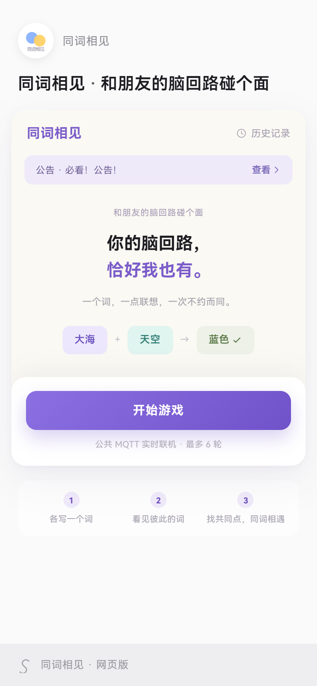
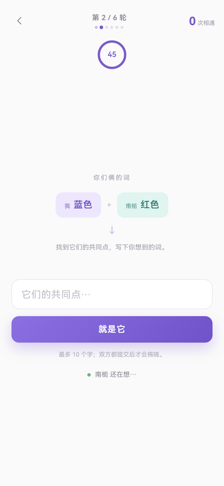
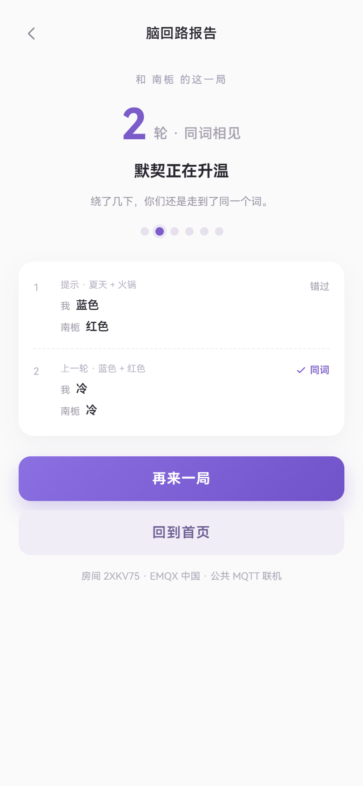
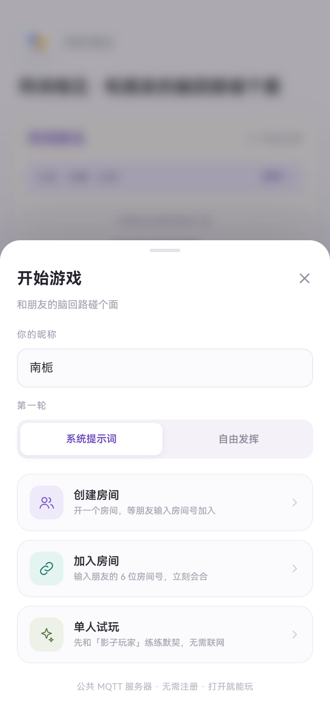

# 同词相见 · 和朋友的脑回路碰个面

> 一个词，一点联想，一次不约而同。

参照截图实现的「同词相见」网页版前端：纯静态文件 + 公共 MQTT 服务器，无后端、无注册。两个人先各自写一个词，互相看到答案后，再一起找这两个词的「共同点」；任何一轮写下同一个词，就是一次同词相见。



## 玩法

1. 创建房间，把 6 位房间号或邀请链接发给朋友。
2. 房主在房间页选择第一轮模式：
   - **系统提示词**（默认）：双方各拿到一个不同的词；
   - **自由发挥**：第一轮没有任何提示，双方各写一个自己想到的词。
3. 第一轮双方各自写下一个词，提交后揭晓。
4. 如果两个人写的是同一个词（忽略空格、标点、大小写）→「同词相见」，本局立即结束。
5. 如果没有撞上，下一轮双方都会看到上一轮彼此写下的两个词——**找出它们的共同点，再各写一个词**。
6. 如果又不同，就继续用刚写下的两个词找共同点，最多 6 轮。任何一轮同词都算相遇，轮数越少默契越高。

示例：`大海 + 天空 → 蓝色`；如果第一轮写出的是 `蓝色 + 红色`，下一轮可以考虑 `冷`、`颜色` 之类的共同点，等两个人写下同一个词就相遇。

## 已实现的功能

- **首页视觉还原**：头像标识、大标题、米白卡片、公告条、主视觉文案、「大海 + 天空 → 蓝色」演示词链、底部入口与「网页版」标识。
- **双人实时联机**：6 位房间号；公共 MQTT 服务器（EMQX / Mosquitto）WSS 直连；支持复制邀请链接 `?room=CODE`。
- **逐轮接近的玩法**：第一轮独立作答 → 揭晓 → 后续每轮用上一轮的两个答案找共同点；同词立即结束，最多 6 轮。
- **第一轮提示可切换**：房主可在开始前切换「系统提示词 / 自由发挥」；联机时以房主设置为准。
- **单人试玩**：「影子玩家」会按常见联想池作答；进入找共同点阶段后，它会从词库关联词里挑一个共同点。
- **完整对局 UI**：45 秒倒计时、轮次圆点、双方答案揭晓、成功/失败结算、再来一局。
- **历史记录**：最近 50 局保存在本地，包含是否相遇、第几轮相遇、每轮题目与答案；首页显示累计局数与相遇次数。
- **稳定性处理**：多公共服务器保底、按房间号确定性选路、5 秒心跳、18 秒掉线判定、断线自动重连、重连后快照同步与答案补发。
- **响应式**：移动端全屏；桌面端居中手机卡片，背景带柔和渐变。

| 找共同点 | 结算 |
| --- | --- |
|  |  |

开始面板里可以先选好第一轮模式（系统提示词 / 自由发挥），房主也能在房间里随时切换：



## 快速开始

### 直接打开

双击 `index.html` 即可。所有依赖都是本地文件（`vendor/mqtt.min.js` 已内置），公共 MQTT 通过 WSS 直连，不需要后端。

### 本地服务器（推荐）

```powershell
npm install      # 仅测试需要；运行页面本身不需要
npm run serve    # → http://127.0.0.1:4173
```

### 部署

把 `index.html`、`assets/`、`vendor/`（以及可选的 `docs/`）原样上传到任意静态托管即可，例如 GitHub Pages、Vercel、Netlify、对象存储。**没有构建步骤。**

分享给朋友时使用房间页的「复制邀请」，会复制类似：

```text
我在「同词相见」开了一个房间，房间号 AB3DEF。
打开 https://your.site/tongci/?room=AB3DEF 来和我的脑回路碰个面。
```

## 目录结构

```text
同词相见/
├─ index.html               # 首页 / 房间 / 对局 / 结算 / 弹窗 的静态骨架
├─ assets/
│  ├─ styles.css            # 全部样式（移动端 + 桌面端）
│  ├─ words.js              # 72 组词对、演示词、昵称、影子玩家词池、结算文案
│  ├─ engine.js             # 纯逻辑：归一化、出题、共同点、计分、房间号、服务器选路
│  ├─ net.js                # MQTT 连接管理（多服务器保底、订阅、重连）
│  └─ app.js                # 页面状态机、房间/对局流程、渲染、历史记录
├─ vendor/
│  ├─ mqtt.min.js           # MQTT.js v5.10.1（本地内置，避免 CDN 失败）
│  └─ mqtt.LICENSE.md
├─ docs/                    # README 预览图
├─ tests/
│  ├─ engine.test.mjs       # 23 个纯逻辑单元测试（node:test）
│  ├─ mqtt-smoke.mjs        # 公共 broker 连通性冒烟测试（Node）
│  ├─ e2e.mjs               # 浏览器 E2E：单人 + 真实 MQTT 双人联机
│  └─ serve.mjs             # 零依赖静态服务器
├─ package.json             # 仅有 devDependencies 与测试脚本
└─ README.md
```

## 技术实现

### 页面状态机

单页应用，四个全屏 `screen`（home / lobby / game / summary）+ 三个覆盖层（开始面板 / 公告 / 历史记录）。`app.js` 用一个 `App` 对象维护模式、角色、房间、网络实例和当前对局，渲染函数只负责把状态映射成 DOM；所有用户输入都会先转义再拼进 HTML。

### 对局数据结构

```js
game = {
  maxRounds: 6,
  firstPrompt: true,              // 第一轮是否有系统提示词
  startPair: { a, b },            // 第一轮的提示词（自由发挥时为空）
  round: 0,
  kind: 'cue' | 'free' | 'bridge',
  cueA, cueB,                     // cue 模式：两人的提示词
  bridge: { host, guest },        // bridge 模式：上一轮双方写下的词
  answers: { host, guest },
  results: [{ kind, prompt, answers, matched }],
  success, roundsUsed,
  phase: 'waiting' | 'writing' | 'revealing' | 'done'
}
```

### MQTT 协议

- 主题：`tongci/v1/<6 位房间号>`
- 消息为 JSON：`{ v: 1, sid, role, name, type, ts, ...payload }`
- 游戏消息 QoS 1，心跳 QoS 0；broker 不保留状态，房主为权威状态源。

| 类型 | 方向 | 作用 |
| --- | --- | --- |
| `hello` / `welcome` | 双向 | 加入/问候，交换昵称、第一轮设置与当前状态 |
| `presence` | 双向 | 5 秒心跳，携带 ready / phase / round / firstPrompt |
| `ready` | 双向 | 准备状态 |
| `setting` | 房主 → 访客 | 同步「第一轮是否有提示词」 |
| `start` / `restart` | 房主 → 访客 | 开局 / 再来一局，携带轮数上限、种子、第一轮设置与提示词 |
| `round` | 房主 → 访客 | 本轮类型（cue / free / bridge）、提示词或上一轮的两个词、倒计时 |
| `answer` | 双向 | 提交本轮答案 |
| `reveal` | 房主 → 访客 | 房主权威揭晓：双方答案、是否同词、是否结束、第几轮相遇 |
| `sync` | 房主 → 访客 | 状态快照（掉线重连/补发后恢复） |
| `finish` | 房主 → 访客 | 对局结束与最终成绩 |
| `requestRestart` | 访客 → 房主 | 请求再来一局 |
| `goodbye` / `leave` | 双向 | 离开房间 |

安全/健壮性：payload 上限 4 KB、忽略同角色消息、丢弃非本房间主题、所有房间号与答案做长度限制、XSS 转义。

### 公共服务器与可用性

沿用了化学棋 Chemiss 的思路：多个免费公共 broker，连接失败自动切换。

- 首选：`wss://broker.emqx.io:8084/mqtt`、`wss://broker-cn.emqx.io:8084/mqtt`
- 保底：`wss://test.mosquitto.org:8081/mqtt`（部分地区/网络不可用，仅第三顺位）
- 房间号经 FNV-1a 哈希后决定首选服务器，**两端按完全相同的顺序尝试**，避免两人落到不同集群；
- 单台连接超时 9 秒，切换下一台；连接成功后由 mqtt.js 每 4 秒自动重连；
- 页面内会显示当前连接的是哪台服务器（如「已连接 · EMQX 国际」）。

> 注意：公共 broker 没有 SLA，也**没有鉴权和私密性**。房间主题可以被同主题的订阅者看到，请勿在昵称/答案里填写真实姓名、联系方式等敏感信息。

### 断线恢复

- 每 5 秒发 `presence`，18 秒收不到对方消息判定掉线，界面提示「对方好像断线了…」；
- 房主在收到 presence 时按 3.5 秒节流下发 `sync` 快照（阶段、轮次、题面、双方答案、比分、剩余时间）；
- 访客重连后 `hello` → 房主 `welcome` + `sync`，恢复到当前轮次；访客提交过但房主没收到的答案会自动补发；
- 已实测：断网 7 秒再恢复，双方能继续同一轮并正常揭晓。

### 影子玩家

- 第一轮：玩家的词在常见联想池里时，55% 想到同一个词，否则换一个备选；玩家的词很特别时，有 10% 的巧合概率撞上。
- 找共同点阶段：先看词库里这对词有没有现成的共同联想；没有就取两个词关联词的交集；再没有就取并集或通用兜底词。

## 测试

```powershell
npm install
npm test            # 23 个逻辑单元测试，约 0.1s
npm run test:mqtt   # 三台公共 broker 冒烟，要求至少两台 EMQX 可用
npm run test:e2e    # 本机 Edge/Chrome + 真实公共 MQTT 的完整 E2E，约 1~2 分钟
```

E2E 覆盖：首页文案与视觉、开始面板、非法房间号、单人第 1 轮、创建房间、邀请链接加入、双方准备、第一轮不同词、共同点轮、同词即结束、双方结算一致、再来一局、离开房间、历史记录与清空、失败结算、自由发挥模式、超时自动揭晓。截图输出在 `tests/screenshots/`（已 gitignore）。

找不到浏览器时设置 `EDGE_PATH`，例如：

```powershell
$env:EDGE_PATH = 'C:\Program Files (x86)\Microsoft\Edge\Application\msedge.exe'
```

## 已知边界

- **这是网页版**，不是微信小程序工程。若要移植小程序：需要在微信后台配置 socket 合法域名，用 `wx.connectSocket` 适配 MQTT 客户端，并把 WXML/WXSS 重写；本项目的协议与逻辑可直接复用。
- 公共服务器没有 SLA，偶发断线/限流；断线重连已处理，但若双方网络对 broker 的可达性不同，可能连不到同一个服务器。
- 房间号 6 位随机、主题无鉴权，理论上可能被猜到；仅适合休闲场景，请勿传输隐私信息。
- 仅支持两人一房，无账号、无观战、无排行榜。
- 「共同点」不判断语义正确性：游戏只比较双方是否写下同一个词，过程是否合理由你们自己决定。

## 许可

- 本项目代码：MIT（见 `LICENSE`）。
- `vendor/mqtt.min.js`：MQTT.js v5.10.1，MIT 许可（见 `vendor/mqtt.LICENSE.md`），来源 <https://github.com/mqttjs/MQTT.js>。
- 首页视觉参考用户提供的截图，仅用于本项目的还原实现。
